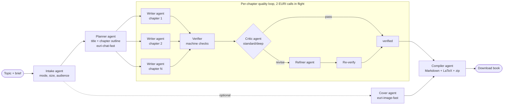

# 📚 BookForge on Euron

**A multi-agent AI book generator powered by the [Euron EURI API](https://euron.one/euri/docs): give it a topic, and a team of agents plans, writes, reviews and compiles a book in Markdown and LaTeX.**

**Live demo:** https://bookforge-euron.onrender.com

[](https://www.python.org/)
[](https://fastapi.tiangolo.com/)
[](https://euron.one/euri)
[](https://google.github.io/adk-docs/)
[](https://bookforge-euron.onrender.com)

BookForge comes in two parts that share one idea, a pipeline of specialised agents with a quality gate:

1. **Web app (`bookforge/web`)**: topic → book. A lean FastAPI app (live on Render, Vercel-ready) that streams live progress and gives you Markdown, LaTeX and a zip.
2. **YouTube pipeline (`bookforge/agents`)**: YouTube channel → print-ready LaTeX/PDF book, one chapter per video, built on **Google ADK**. It runs locally or in a container because it needs ffmpeg, yt-dlp, Whisper and pdflatex.

Both call the LLM through **Euron EURI** (OpenAI-compatible) and default to Euron-hosted `euri-*` models.

---

## ✨ Features

- **Multi-agent pipeline**: intake → planner → chapter writers → verifier → critic → refiner → compiler.
- **Three modes**: ⚡ *Quick* (4 chapters, about 30-60 s), 📘 *Standard* (6 chapters plus critic review and revision), 🧠 *Deep* (6 longer chapters written by `euri-chat-smart`, budget-guarded to stay inside the function limit).
- **Live streaming progress**: the UI shows the outline, then each chapter moving through writing → review → revision → verified.
- **Deterministic quality gate**: machine checks for length, structure, a Key Takeaways section and leftover assistant chatter run before and after the LLM critic.
- **Downloads**: `book.md`, a standalone `book.tex` (compile with `pdflatex`), and a zip with both plus `book.json` metadata.
- **Optional cover art** with `euri-image-fast`.
- **Respects EURI limits**: one process-wide semaphore keeps requests at 2 in flight (EURI's concurrency cap), with retries and backoff on 429/5xx.
- **Serverless-friendly**: a small dependency set, writes only to `/tmp`, `GET /api/health` reports whether the key is configured (never its value), and the UI shows a clear message when `EURI_API_KEY` is missing.
- **Optional access code**: set `BOOKFORGE_ACCESS_CODE` to stop strangers from spending your EURI quota.

## 🧠 Agent pipeline



The ADK YouTube pipeline follows the same shape, with ADK `SequentialAgent`/`LoopAgent` graphs: channel intake → media acquisition (yt-dlp, captions, Whisper fallback, frame extraction) → transcript analyst → visual assets → chapter writer → verifier/critic/refiner loop → LaTeX book compiler. See [`docs/solution-architecture.md`](docs/solution-architecture.md).

## 🛠 Tech stack

| Layer | Tech |
| --- | --- |
| LLM | [Euron EURI API](https://euron.one/euri/docs) (OpenAI-compatible): `euri-chat-fast`, `euri-chat-smart`, `euri-image-fast` |
| Web | FastAPI, NDJSON streaming, vanilla JS UI (marked + DOMPurify) |
| Agents (YouTube pipeline) | Google ADK (`LlmAgent`, `SequentialAgent`, `LoopAgent`), routed to EURI through ADK's OpenAI-compatible model wrapper |
| Media | yt-dlp, faster-whisper, ffmpeg, imagehash, matplotlib |
| Output | Markdown, LaTeX (`book` class), PDF via pdflatex (locally) |
| Hosting | Render web service (live demo); Vercel Python runtime also supported |
| Tests | pytest, pytest-asyncio, httpx `MockTransport` (fully offline) |

## 🔑 Euron EURI setup

1. Sign in at [euron.one](https://euron.one) and open **[EURI](https://euron.one/euri)** to create an API key.
2. Export it as `EURI_API_KEY`. BookForge sends it as a Bearer token to `https://api.euron.one/api/v1/euri`.
3. The defaults use Euron-hosted models (`euri-chat-fast`, `euri-chat-smart`, `euri-image-fast`). On Euron Plus these don't count against the daily token cap that outside models (`gpt-*`, `gemini-*`, `claude-*`) share. Every model name can be overridden with an env var.

Check your key:

```bash
curl -s https://api.euron.one/api/v1/euri/chat/completions \
  -H "Authorization: Bearer $EURI_API_KEY" -H "Content-Type: application/json" \
  -d '{"model":"euri-chat-fast","messages":[{"role":"user","content":"Say hi"}]}'
```

## 🚀 Local setup

```bash
git clone https://github.com/Yash-Kavaiya/BookForge-Euron.git
cd BookForge-Euron
python -m venv .venv && source .venv/bin/activate
pip install -e . uvicorn            # web app only (light)
cp .env.example .env                # then put your EURI_API_KEY in .env (or export it)
export EURI_API_KEY=your-euri-key
uvicorn app:app --reload            # open http://127.0.0.1:8000
```

**YouTube pipeline (Google ADK)**, which also needs `ffmpeg` and `pdflatex`:

```bash
pip install -e ".[pipeline]"         # + ".[observability]" for MLflow / Langfuse tracing
python -m bookforge.main "https://www.youtube.com/@SomeChannel" --max-videos 2 --verbose
# or the ADK dev UI:
adk web                              # pick "bookforge", paste a channel URL
```

Output for that pipeline goes to `data/<channel-slug>/book/book.pdf`, and reruns resume where they stopped.

### API

| Method | Path | Description |
| --- | --- | --- |
| `GET` | `/` | Web UI |
| `GET` | `/api/health` | `{"status":"ok","euri_configured":true,...}`, never the key itself |
| `GET` | `/api/modes` | Chapter counts and word targets per mode |
| `POST` | `/api/generate` | Body `{"topic": "...", "brief": "", "audience": "", "tone": "", "language": "English", "mode": "quick", "cover": false}`. Returns an NDJSON stream of `start` / `stage` / `outline` / `chapter` / `ping` events, then `done` (with `markdown`, `latex`, `zip_base64`, `meta`) or `error`. |

```bash
curl -N -X POST http://127.0.0.1:8000/api/generate \
  -H "Content-Type: application/json" \
  -d '{"topic":"A beginner guide to vector databases","mode":"quick"}'
```

## ⚙️ Environment variables

| Variable | Default | Used by | Description |
| --- | --- | --- | --- |
| `EURI_API_KEY` | none (**required**) | both | Your Euron EURI API key |
| `BOOKFORGE_EURI_API_BASE` | `https://api.euron.one/api/v1/euri` | both | EURI base URL |
| `BOOKFORGE_LLM_MAX_CONCURRENCY` | `2` | both | Max EURI requests in flight |
| `BOOKFORGE_WEB_PLANNER_MODEL` | `euri-chat-fast` | web | Outline / planner agent |
| `BOOKFORGE_WEB_WRITER_MODEL` | `euri-chat-fast` | web | Chapter writer + refiner (quick/standard) |
| `BOOKFORGE_WEB_DEEP_WRITER_MODEL` | `euri-chat-smart` | web | Chapter writer in deep mode |
| `BOOKFORGE_WEB_CRITIC_MODEL` | `euri-chat-fast` | web | Critic agent |
| `BOOKFORGE_WEB_IMAGE_MODEL` | `euri-image-fast` | web | Optional cover image |
| `BOOKFORGE_WEB_TIME_BUDGET` | `270` | web | Seconds after which optional review/revision steps are skipped |
| `BOOKFORGE_WEB_REQUEST_TIMEOUT` | `120` | web | Per-request EURI timeout (s) |
| `BOOKFORGE_WEB_MAX_JOBS` | `3` | web | Concurrent generations per instance |
| `BOOKFORGE_WEB_OUTPUT_DIR` | `/tmp/bookforge` | web | Where finished books are written |
| `BOOKFORGE_ACCESS_CODE` | none | web | If set, `/api/generate` requires this code |
| `BOOKFORGE_ANALYST_MODEL` / `WRITER_MODEL` / `CRITIC_MODEL` / `REFINER_MODEL` | `euri-chat-fast` / `euri-chat-smart` / `euri-chat-fast` / writer | pipeline | Model per ADK stage |
| `BOOKFORGE_LLM_MAX_OUTPUT_TOKENS` | `8192` | pipeline | EURI output cap |
| `BOOKFORGE_QA_LLM_CRITIC_MODE` | `once` | pipeline | `once` / `always` / `never` |
| `BOOKFORGE_QA_MAX_ITERATIONS` | `3` | pipeline | Verifier → critic → refiner rounds per chapter |
| `BOOKFORGE_COMPILE_LATEX` | `true` | pipeline | Run pdflatex in QA and the final compile |
| `BOOKFORGE_TRANSCRIPT_MAX_CHARS` | `36000` | pipeline | Transcript budget per video for EURI's 32k context; longer videos are sampled evenly |
| `BOOKFORGE_BOOK_TITLE` | channel/playlist title + "— The Complete Book" | pipeline | Title for the compiled book |
| `BOOKFORGE_VIDEO_ORDER` | `auto` | pipeline | `auto` (by upload date when known, else playlist order), `playlist`, or `reverse` (for newest-first playlists) |

[`.env.example`](.env.example) lists every option.

## 🧪 Tests

The whole suite runs offline. EURI is replaced by an `httpx.MockTransport` (web) or a scripted ADK model (pipeline), so no key or network is needed.

```bash
pip install -e ".[pipeline]" pytest pytest-asyncio uvicorn
pytest                                 # whole suite
pytest tests/test_web_pipeline.py tests/test_web_app.py   # web app only (needs just the core deps)
```

The web tests cover the full quick and standard runs, the 2-request concurrency cap, retries on 429, rejected keys, the missing-key UX, the access-code gate, the streamed events and the zip/`/tmp` outputs, and LaTeX escaping.

## ☁️ Deploy on Render (live demo host)

The live demo runs on a [Render](https://render.com) free Python web service in Singapore. Every push to `main` redeploys it.

1. Click **New → Blueprint** in Render and pick this repo. [`render.yaml`](render.yaml) sets up the service. Or create a Python **Web Service** by hand with:
   - Build command: `pip install --upgrade pip && pip install . 'uvicorn[standard]>=0.30'`
   - Start command: `uvicorn app:app --host 0.0.0.0 --port $PORT`
   - Health check path: `/api/health`
2. Add the environment variable **`EURI_API_KEY`** (and `PYTHON_VERSION=3.12.8`). You can also add `BOOKFORGE_ACCESS_CODE`.
3. Deploy, then open `/api/health`: `euri_configured` should be `true`.

**Hosting notes**

- Free Render services sleep after about 15 minutes without traffic, so the first request after a pause takes up to a minute while the service wakes up.
- There's no TeX on the server, so the site returns LaTeX source. Compile the PDF locally with `pdflatex book.tex` (run it twice for the table of contents).
- *Quick* takes about 30-60 s. The pipeline's time budget (`BOOKFORGE_WEB_TIME_BUDGET`, 270 s) also keeps *Deep* bounded.
- The app only writes to `/tmp`. Downloads come straight from the streamed result, so nothing depends on it.
- **Vercel** works too: `app.py` is auto-detected (`[tool.vercel] entrypoint = "app:app"`) and `vercel.json` sets `maxDuration` to 300 s. Import the repo and add `EURI_API_KEY`.
- The YouTube/ADK pipeline needs ffmpeg, Whisper and long runtimes. Run it from the Dockerfile on a container host instead; see [`deployment/README.md`](deployment/README.md).

## 🗂 Project structure

```
BookForge-Euron/
├── app.py                     # uvicorn / Render / Vercel entrypoint (FastAPI `app`)
├── render.yaml                # Render Blueprint (live demo)
├── vercel.json                # Vercel maxDuration (optional host)
├── pyproject.toml             # core (web) deps + [pipeline] / [observability] extras
├── bookforge/
│   ├── web/                   # topic → book web app
│   │   ├── app.py             # FastAPI routes, NDJSON streaming, /tmp + zip output
│   │   ├── pipeline.py        # intake/planner/writer/verifier/critic/refiner/compiler agents
│   │   ├── euri_client.py     # async EURI client: shared 2-slot semaphore, retries
│   │   ├── latex_export.py    # Markdown → LaTeX book (pure Python)
│   │   ├── settings.py        # env-driven settings
│   │   └── static/            # index.html UI + favicon
│   ├── agents/                # Google ADK YouTube → book agents (orchestrator, intake, media,
│   │                          #   analyst, assets, writer, verifier, critic, compiler)
│   ├── agents/model_resolver.py  # routes every ADK model call to EURI
│   ├── tools/                 # latex, frames, qa_checks, workspace, youtube, media_acquire
│   ├── integrations/          # MLflow / OpenTelemetry tracing
│   ├── config.py · prompts.py · schemas.py · main.py (CLI)
├── tests/                     # offline pytest suite (web + pipeline)
├── eval/                      # ADK eval sets
├── deployment/                # container / Cloud Run notes for the YouTube pipeline
└── docs/                      # architecture and planning notes
```

## 🙏 Credits

Ported from **[Yash-Kavaiya/BookForge-Google-ADK](https://github.com/Yash-Kavaiya/BookForge-Google-ADK)**. This port moves the LLM layer from Gemini/NVIDIA NIM to the Euron EURI API, drops the Go implementation, and adds a deployable FastAPI web app. Built with help from [Euron Code](https://euron.one/code-agent).

## 📄 License

Apache License 2.0, the same as the original project. See [LICENSE](LICENSE).
